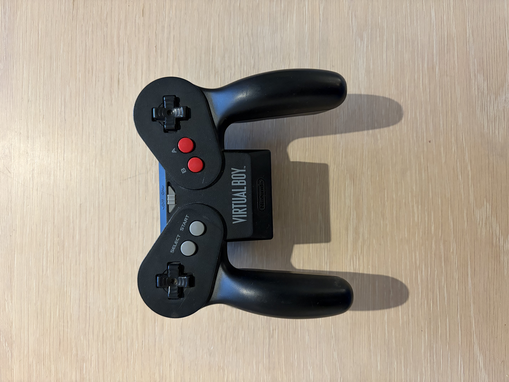
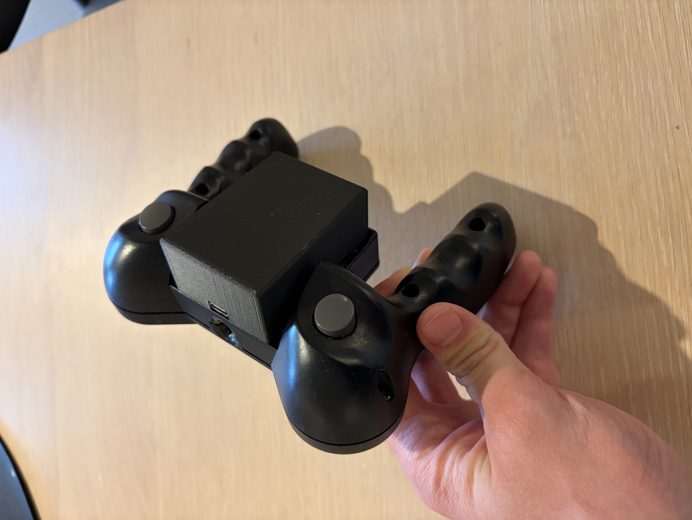
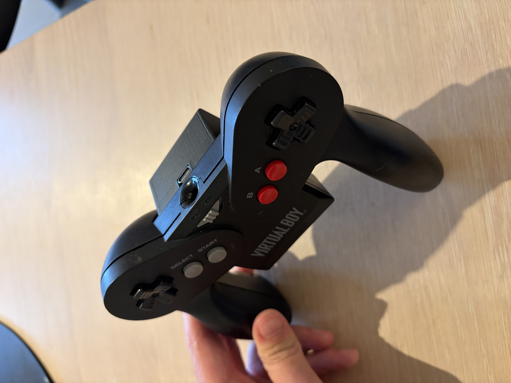
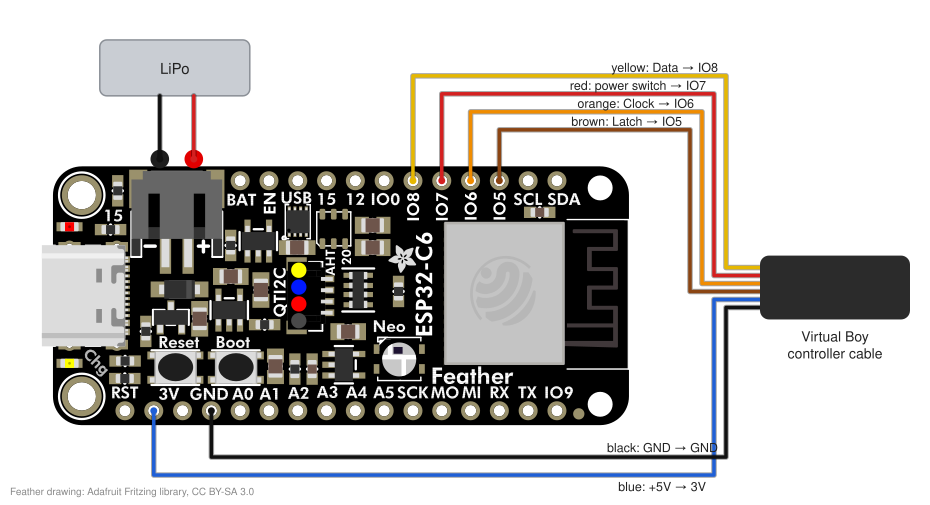

# Redtooth

Open-source Bluetooth mod for the original Virtual Boy controller, using an Adafruit ESP32-C6 Feather.

  

## Modes

Hold a button while switching on; holding none keeps the last mode. The LED blinks while waiting for a connection.

| Hold | LED   | Acts as                                         | Pairing                                          |
|------|-------|-------------------------------------------------|--------------------------------------------------|
| L    | blue  | generic BLE gamepad (Android)                   | "Virtual Boy Controller" in Bluetooth settings   |
| R    | green | Xbox Wireless Controller, e.g. for a Windows PC | "Xbox Wireless Controller" in Bluetooth settings |
| A    | red   | Switch 2 Pro Controller                         | Change Grip/Order, once; it reconnects by itself after that |

Xbox mode also works through an 8BitDo Wireless USB Adapter 2: hold the adapter's button until it blinks fast.

## Controls

Right D-pad = right stick. Select + L: left D-pad as D-pad or left stick. Select + B: swap A and B.
Select + A for 3 s: forget all pairings. Xbox / Switch 2: Start = Menu / +, Select = View / −, Select + Start = Xbox / HOME, Select + R = Share / Capture.

## Wiring

Wire colours of the original controller cable; the controller runs fine on the Feather's 3 V.

The red wire originally carried the battery pack's power through the power switch to the console. Cut it inside the
controller and wire the end that comes from the switch to IO7. Switching off then connects IO7 to GND and the Feather,
which keeps running on its own LiPo, goes into deep sleep. It has to be IO7: only IO0–IO7 can wake the C6.

Drawn by `docs/wiring.py`.

## Mounting and battery pack cover

The Feather and the LiPo sit in the controller's battery pack compartment, held with double-sided tape, the Feather
centred with its USB-C port at the top. The wires reach the inside of the controller through its battery contact holes,
so the controller's shell needs no cutting or drilling.

`batteryPackCover/` holds the 3D-printable cover that slides over the compartment in place of the original battery pack,
with an opening for the USB-C port: the FreeCAD model (`MainBody.FCStd`) and a 3MF ready to print (`MainBody-Body.3mf`).

## Build

Firmware in `idf/`, for ESP-IDF 6.1: `cd idf`, then `idf.py build flash`.

The Switch 2 needs a 5 ms connection interval, below the Bluetooth LE minimum. `idf/cmake/ble_interval_patch.cmake`
allows it by patching one instruction in a build-local copy of `libble_app.a`; ESP-IDF itself is not changed.

## Credits

Switch 2 protocol ported from [ESP32-BLE5-NSController-Emulator](https://github.com/2017fighting/ESP32-BLE5-NSController-Emulator)
(MIT, `idf/main/switch2/LICENSE`), based on [switch2_controller_research](https://github.com/ndeadly/switch2_controller_research).
Feather drawing in `docs/wiring.svg` from [Adafruit's Fritzing library](https://github.com/adafruit/Fritzing-Library) (CC BY-SA 3.0).
